  <a href="https://usenock.com">
    <picture>
      <source media="(prefers-color-scheme: dark)" srcset="assets/header-dark.svg">
      
    </picture>
  </a>

  A Nock faz prospecção B2B para empresas brasileiras: encontra as empresas e os
  decisores no momento da compra e manda a primeira mensagem pelo e-mail e pelo
  LinkedIn do próprio cliente.

  <a href="https://usenock.com"><b>usenock.com</b></a>
  &nbsp;&nbsp;|&nbsp;&nbsp;
  <a href="https://usenock.com/mcp"><b>usenock.com/mcp</b></a>

 

  <a href="https://github.com/nock-ltda/nock-mcp">
    <picture>
      <source media="(prefers-color-scheme: dark)" srcset="assets/nock-mcp-card-dark.svg">
      
    </picture>
  </a>

<h3 align="center">Funciona com</h3>

  <picture>
    <source media="(prefers-color-scheme: dark)" srcset="assets/works-with-dark.svg">
    
  </picture>

  Nock does B2B prospecting for Brazilian companies: it finds the companies and decision makers at the moment of purchase and sends the first message from the customer's own e-mail and LinkedIn.

